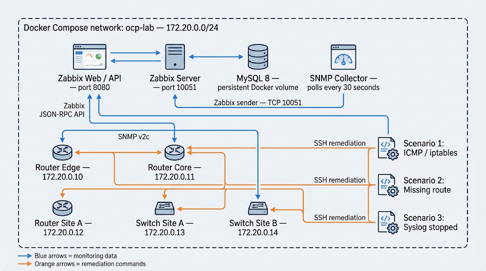

# OCP Network Monitoring and Auto-Remediation Lab

A Docker Compose lab that models five network devices, monitors them through SNMP and Zabbix, and runs Python workers that can remediate selected detected problems over SSH.

## Architecture

The five Alpine containers act as network devices. Each exposes SNMP inside the Compose network and runs SSH for the automation workers. The collector polls three SNMP metrics (route, iptables, and syslog) every 30 seconds and submits values to Zabbix. Three separate Python workers poll Zabbix's active triggers every 30 seconds and use SSH to attempt a matching repair. Zabbix uses MySQL for persistent data; `mysql_data` survives container recreation unless explicitly removed.

### Services and host access

| Service | Purpose | Host access |
|---|---|---|
| `zabbix-web` | Zabbix web interface and JSON-RPC API | http://localhost:8080 |
| `zabbix-server` | Zabbix server and sender receiver | TCP 10051 |
| `mysql` | Zabbix database | Internal Compose network only |
| `router-edge`, `router-core`, `router-site-a` | Simulated routers | Internal Compose network only |
| `switch-site-a`, `switch-site-b` | Simulated switches | Internal Compose network only |
| `snmp-collector` | SNMP polling and Zabbix sender | Internal Compose network only |
| `scenario1`, `scenario2`, `scenario3` | Trigger-based remediation workers | Internal Compose network only |

The bridge network assigns static device addresses from `172.20.0.10` through `172.20.0.14`. Containers resolve one another by Compose service name. The Docker host publishes the web UI at port 8080 and Zabbix server at port 10051.

## Requirements

- Docker Desktop (or Docker Engine) with Docker Compose v2.
- Network access the first time you start the lab, so Docker can pull the service images and Alpine can install packages.
- Free host ports `8080` and `10051`.

## Start the lab

Run these commands from this folder:

```sh
docker compose config
docker compose up --build -d
docker compose ps
```

`docker compose config` checks that Compose can parse the configuration. The first startup can take a few minutes while images are downloaded and device packages are installed.

Open [http://localhost:8080](http://localhost:8080) and sign in with the default Zabbix credentials:

- Username: `Admin`
- Password: `zabbix`

The `configure_zabbix.py` helper can update the interface IP addresses of already existing matching Zabbix hosts. It does not create hosts, items, triggers, or templates.

```sh
docker compose run --rm --entrypoint python scenario1 configure_zabbix.py
```

For SNMP values to appear and remediation to occur, configure the corresponding Zabbix hosts/items/triggers so they accept the `snmp.route`, `snmp.iptables`, and `snmp.syslog` keys and use trigger descriptions that match the scenario workers. The expected trigger description text is `Iptables bloque ICMP`, `Route manquante`, and `Syslog arrete`. The scripts and Compose file do not provision this Zabbix monitoring configuration automatically.

## Inspect and manage the lab

```sh
# Follow all service logs
docker compose logs -f

# Follow one service
docker compose logs -f snmp-collector
docker compose logs -f scenario1

# Show service state
docker compose ps

# Restart services
docker compose restart

# Stop and remove containers and the Compose network
docker compose down

# Also remove the persisted MySQL data (deletes Zabbix database state)
docker compose down -v
```

Automation activity is also appended to `logs/auto_remediate.log`, which is shared with the Python containers.

## Lab scenarios

1. **ICMP / iptables:** If Zabbix reports a trigger whose description contains `Iptables bloque ICMP`, the worker attempts to delete an INPUT rule that drops ICMP echo requests.
2. **Default route:** If a trigger contains `Route manquante`, the worker attempts to add a default route via `172.20.0.1`, then checks the route table.
3. **Syslog:** If a trigger contains `Syslog arrete`, the worker starts `syslogd` and checks for its process.

All three workers use SSH credentials configured in the source (`root` / `ocp123`). These are lab-only credentials; change them before using the setup beyond an isolated learning environment.

## Repository files

- `docker-compose.yml` — service definitions, bridge network, IP addresses, ports, volumes, and startup commands.
- `Dockerfile`, `requirements.txt` — Python worker image and dependencies.
- `common.py` — shared Zabbix API, SSH, and logging helpers.
- `scenario1_iptables.py`, `scenario2_route.py`, `scenario3_syslog.py` — remediation workers.
- `snmp_collector.py` — polls device SNMP values and sends them to Zabbix.
- `configure_zabbix.py` — aligns interface IPs for matching hosts already present in Zabbix.
- `backup_configs.py`, `backups/` — configuration backup utility and saved example snapshots.
- `snmpd-*.conf` — SNMP daemon configuration mounted into each simulated device.
- `logs/` — shared automation log directory.

## Troubleshooting

- If the web UI is unavailable, check `docker compose ps` and `docker compose logs zabbix-web zabbix-server mysql`. Zabbix may need time to initialize its database on first run.
- If Compose reports that a port is in use, stop the process using port `8080` or `10051`, or adjust the corresponding `ports` entries in `docker-compose.yml`.
- If the bridge subnet conflicts with another Docker network, change the `172.20.0.0/24` subnet and update the static addresses in `docker-compose.yml`, the Python scripts, and the SNMP collector together.
- `depends_on` controls startup order but does not guarantee that Zabbix is ready. The remediation scripts retry API authentication for up to 120 seconds; inspect their logs if a worker exits during initial startup.
- Zabbix containers and agents start without a preloaded set of lab hosts, items, templates, or triggers. Add those in Zabbix before expecting metrics and automatic remediation.
